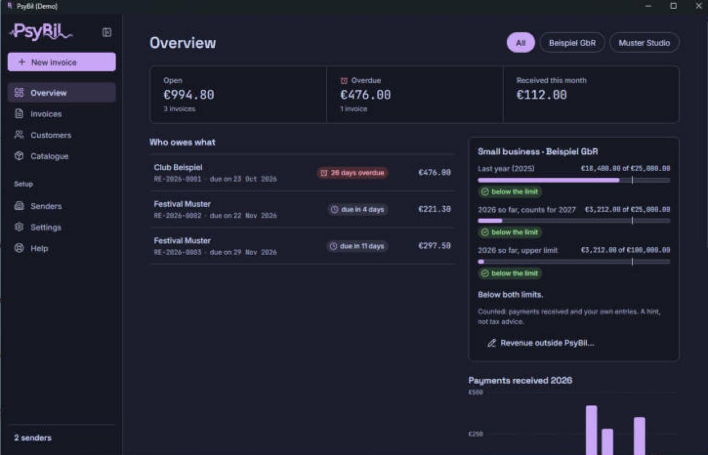
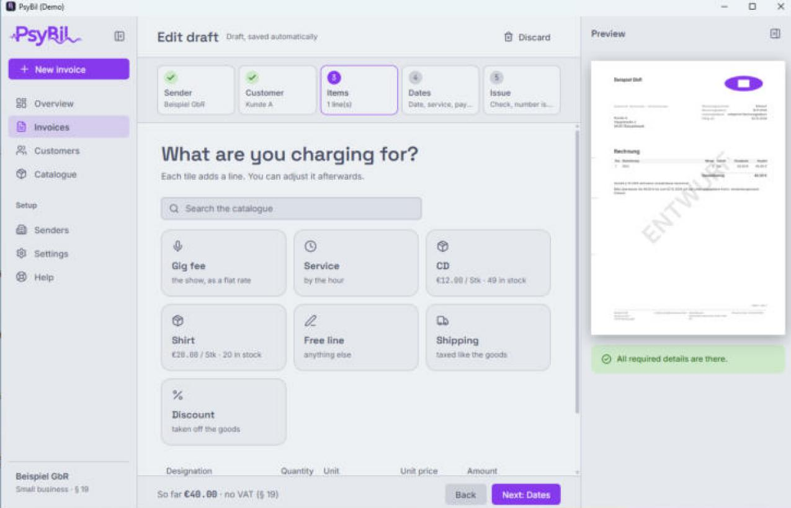
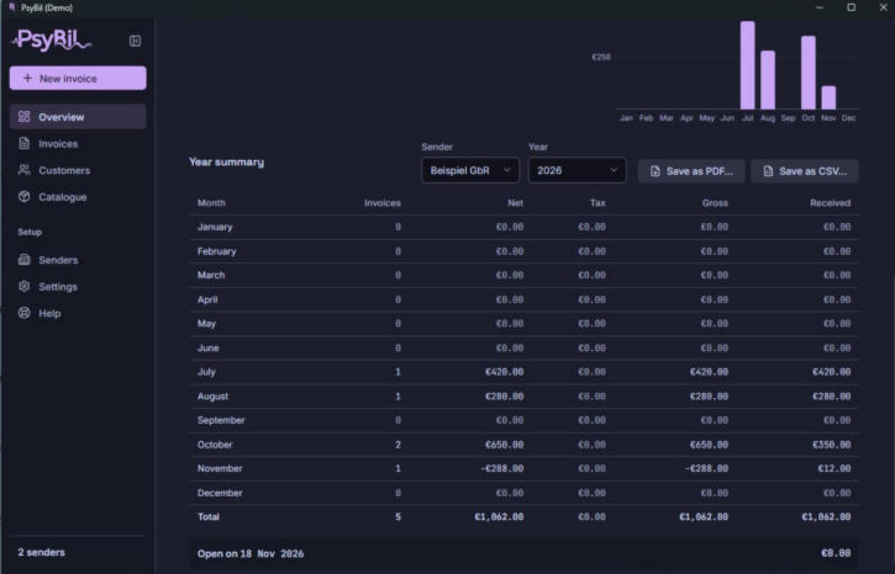
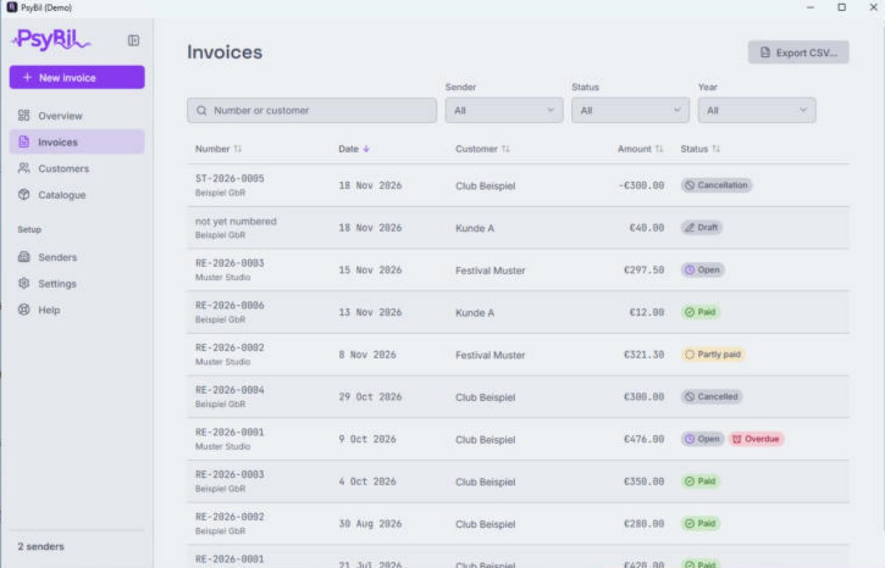

# PsyBil

PsyBil writes invoices for musicians, bands and other small businesses: from the draft through issuing, payments and cancellation to the year summary, with correct German VAT handling and the small-business rule (§ 19 UStG). It runs offline. Your data stays on your computer or in a folder you share.



## Features

- **Senders and brands:** one or more businesses, each with its brands (logo, colour, PDF template) and gap-free invoice numbers per business and year, like `RE-2026-0001`.
- **New invoice assistant:** five steps with the real PDF growing beside it. Before issuing, PsyBil checks the details an invoice must carry and says what is missing.
- **Issued means frozen:** an issued invoice cannot be changed or deleted. Payments, also partial ones, set its status. A mistake is corrected by a cancellation and a replacement invoice, which takes over what was already paid.
- **Small business (§ 19 UStG):** no VAT on the invoice, the required note printed, and a meter that shows how close last year and this year are to the limits. The meter is a hint, not tax advice.
- **Overview:** open and overdue amounts, who owes what since when, and payments per month.
- **Exports:** PDF in three templates, archived as PDF/A when an invoice is issued; the year summary as PDF and CSV; the invoice list as CSV that Excel and LibreOffice open in the right columns.
- **Customers and catalogue,** with stock that goes down when an invoice is issued and back with a cancellation.
- **Backups:** one a day at start (the last 10 are kept) and whenever you want. Restoring checks the file first and backs up the current state.
- English and German, light and dark, keyboard use throughout, and help by task (F1).



## Download

| System | File |
|---|---|
| Windows 10 and 11 | `PsyBil-Setup-<version>.exe` |
| Linux, any distribution | `PsyBil-<version>-x86_64.AppImage` |
| Debian, Ubuntu, Mint | `psybil_<version>_amd64.deb` |
| Fedora, openSUSE | `psybil-<version>-1.x86_64.rpm` |
| macOS, Apple Silicon and Intel | `PsyBil-<version>-macOS.dmg` |

The files are on the [releases page](https://github.com/Psychotoxical/PsyBil/releases). The macOS app is signed and notarized by Apple.



## Where your data lives

PsyBil keeps its data in one database file in its data folder:

| System | Folder |
|---|---|
| Windows | `%APPDATA%\app.psybil` |
| macOS | `~/Library/Application Support/app.psybil` |
| Linux | `~/.local/share/app.psybil` (settings in `~/.config/app.psybil`) |

Backups are in `backups` inside that folder, also when the data itself lives in a shared folder. A backup is a plain SQLite file.

To look around without touching your data, start PsyBil with `--demo`: it opens with example data in a temporary folder and removes it again when you close it. To try things with data of your own but apart from your real data, set the environment variable `PSYBIL_HOME` to a folder; PsyBil then keeps its data and settings there.

## Several computers

On the first start, or later in the settings, you can choose a shared folder, for example in Nextcloud. Each computer then works on its own copy and writes it back to the folder:

- Only one computer writes at a time. The others show "Being edited on …" and can only read; when the first one closes PsyBil, they are told and can take over.
- If a computer crashed, its lock runs out after five minutes, and the next one takes over with one click.
- If both sides changed something anyway, for example while offline, PsyBil merges the changes and asks only where both changed the same entry. Conflict copies made by the sync program are found and merged too.

## Taking over from VibeBill

Settings → Take over from VibeBill reads a VibeBill database; PsyBil finds the usual one on its own. It walks you through the senders, matches customers and items PsyBil already knows, and shows every invoice with a proposal for what happened to it. The old file is only read, and PsyBil makes a backup before it takes anything over.



## Building from source

You need Node.js 24, Rust (stable) and the [Tauri prerequisites](https://tauri.app/start/prerequisites/) for your system.

```
npm ci
npm run tauri dev
```

`npm run tauri build` builds the packages for your system. The checks CI runs are listed in [CONTRIBUTING.md](CONTRIBUTING.md).

The code is split in three: `crates/core` is the Rust core with every rule, calculation and file format; `src-tauri` holds the commands the window may call; `src` is the window in React.

## License

[GNU General Public License v3.0](LICENSE). The fonts Inter, Space Grotesk and JetBrains Mono are under the SIL Open Font License 1.1.
